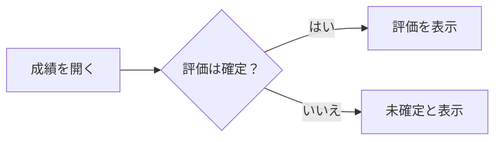

# システム設計Ⅰ
## 次の見出し

- 要件定義
- 外部設計

この授業は特に　*ここ*　が重要です　

>ここのサイトから調べました

[いわきコンカレ](https://www.iwaki-cc.ac.jp)


| 項目名 | 型 | 右揃え↓ | 中央揃え↓ |
|---|---|---:|:---:|
| 学籍番号 | 文字 | 5 | 〇 |
| 科目名 | 文字 | 60 | 〇 |
| 素点 | 数値 | 3 | |

```sql
SELECT * FROM 履修
WHER 評価 IS NULL;
```

- [ ] Markdown Editor でプレビューできる
- [x] ← [x] を入れると ☑ が入る
- [x] ← - [ ] でチェックボックスが作れる


